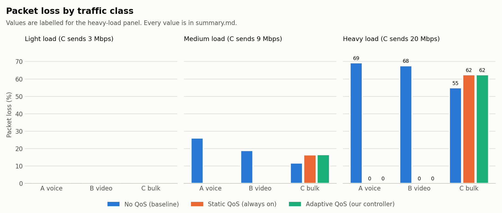
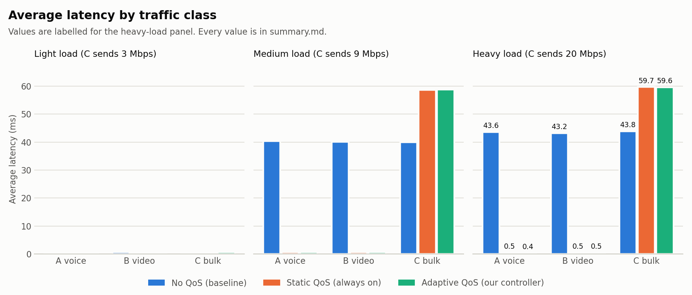
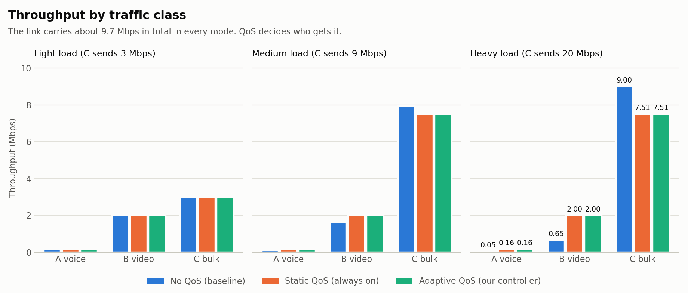
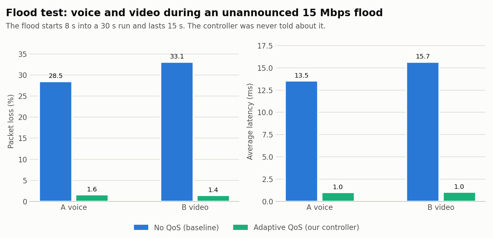
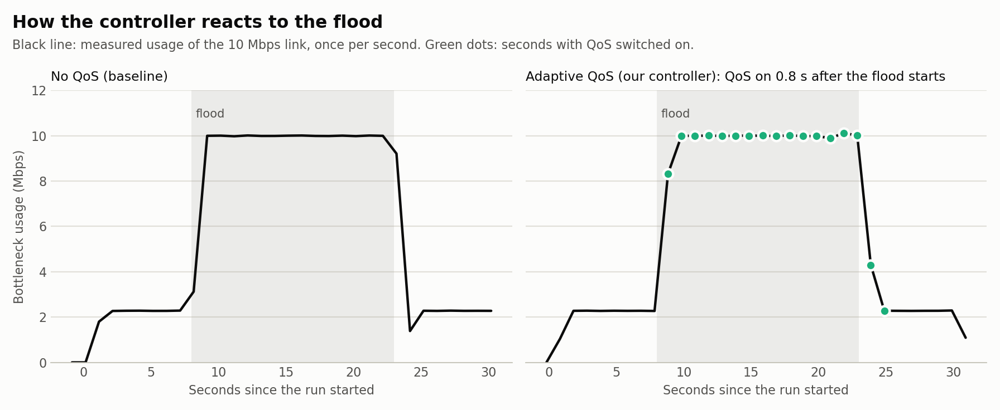

# QoS Traffic Management System (UDP) with SDN

**Computer Networks, SDN-Socket Programming, Jackfruit Mini Project 5**
**Team 21:** Amogh Ankalkoti, Ajmal Abdul Rasheed, Anand Husenappa Ontettin

## 1. The problem
Many kinds of traffic share one network link. Voice calls and video need low delay and almost no loss. A big file download does not. When the link is full (congestion), everything suffers equally, and the voice call breaks up.

## 2. Our solution
A UDP application sends four kinds of traffic. A Ryu SDN controller watches the shared link and, when it gets congested, tells the switch to put voice and video in faster queues, so the bulk traffic absorbs the loss.

| Class | Traffic | Rate | Packet size | UDP port |
|---|---|---|---|---|
| A | Voice | 0.16 Mbps | 200 B | 5001 |
| B | Video | 2 Mbps | 1000 B | 5002 |
| C | Bulk transfer | 3 / 9 / 20 Mbps | 1400 B | 5003 |
| R | Rogue flood (unregistered) | 15 Mbps | n/a | 5004 |

## 3. Architecture
- **Topology (Mininet):** a dumbbell. Senders h1, h2, h3 connect to switch s1. Receivers h4, h5, h6 connect to switch s2. The s1-s2 link is the 10 Mbps bottleneck, with four queues.
- **UDP application:** `app/sender.py` and `app/receiver.py`. Each packet carries a 13-byte header (type, sequence number, timestamp). The receiver measures loss, throughput, latency and jitter (RFC 3550).
- **SDN controller (Ryu, OpenFlow 1.3):** `controller/qos_controller.py`.
  - It works as a learning switch.
  - It installs QoS rules that match the UDP destination port, put the packet in a queue and send it out of the bottleneck port.
  - **Socket-SDN integration:** the sender registers each flow with the controller over a Unix socket (`/tmp/qos_ctrl.sock`), so application events influence the network.
  - **Monitoring:** the controller reads port statistics every 1 second. QoS switches ON at 80% utilisation (or demand) of 10 Mbps. It switches OFF after 3 calm polls below 50% (hysteresis, so it does not flap).
  - A runtime policy file (`controller/policy.json`) selects the mode: off (baseline), always (static) or adaptive.
- **Queues on the bottleneck (HTB, 10 Mbps):** queue 1 voice (priority 1), queue 2 video (priority 2), queue 3 bulk (priority 3), queue 0 everything else.

## 4. Folder map
    app/          sender.py, receiver.py (UDP application)
    topology/     qos_topo.py (Mininet topology and queues)
    controller/   qos_controller.py (Ryu app), policy.json
    experiments/  run_experiments.py, plot_results.py
    results/      results.csv, util_log.csv, controller_events.csv,
                  summary.md, fairness.txt, figures/

## 5. How to reproduce
Use Ubuntu 22.04 with Mininet, Open vSwitch, Ryu and `python3-matplotlib` installed.

Terminal 1 (controller):

    cd ~/qos-project
    sudo mn -c
    ryu-manager controller/qos_controller.py

Terminal 2 (experiments, wait for Ryu to start first):

    cd ~/qos-project
    sudo python3 experiments/run_experiments.py          # full set
    sudo python3 experiments/run_experiments.py quick    # heavy load only
    python3 experiments/plot_results.py                  # graphs and tables

Run `sudo mn -c` before starting Ryu, never after, because it kills Ryu.

## 6. Test cases
1. Three loads (C sends 3, 9, 20 Mbps), each in three modes: **baseline** (no QoS), **static** (QoS always on) and **adaptive** (our controller). Each run lasts 20 s.
2. **Challenge scenario (flood):** voice and video run for 30 s. After 8 s an unregistered rogue flood of 15 Mbps starts and lasts 15 s. The controller is not told about it and must detect it from port statistics.

## 7. Results
All numbers are in `results/summary.md`.

Main findings:
- **Heavy load, no QoS:** voice and video lose about 60-69% of their packets, with about 43 ms latency.
- **Heavy load, with QoS (static or adaptive):** voice and video lose 0% with about 0.4 ms latency. Bulk traffic pays the cost (about 62% loss, about 60 ms latency).
- **Total throughput** is about 9.7 Mbps in every mode, so QoS decides who gets the link; it does not waste it.
- **Flood test:** the controller turned QoS on about 0.83 s after the flood began. The small remaining loss for voice (1.6%) and video (1.44%) comes from that reaction delay. It turned QoS off after the flood ended.
- **Fairness:** Jain's index at heavy load drops from 0.969 (baseline) to 0.879 (QoS). This is expected, because QoS deliberately favours some classes.

## 8. Limits
- One run per condition, so small differences are not statistically proven.
- A few isolated maximum-latency spikes appear; we treat them as outliers.
- The controller reacts at 1 s polling resolution.
